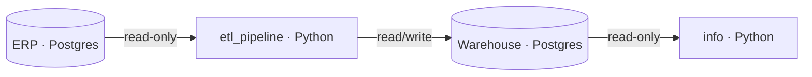

# Daataa

Information is key: the more you know, the better your decisions. That's a universal truth.

Daataa takes that literally. It's a passion project born from wanting to understand data, systems and decision making from the inside - not just the dashboards at the end, but everything that has to go right before them.

## Overview

Daataa extracts data from an ERP database, moves it through a Python pipeline and loads it into a warehouse, where it can be analysed.

**Status:** early. Both databases run in isolated networks with least-privilege roles and health checks. The pipeline itself is next.

## Architecture



| Role | Database | Access |
|---|---|---|
| ERP user | ERP | Read-only |
| Warehouse ETL user | Warehouse | Read and write data, no schema changes |
| Warehouse user | Warehouse | Read-only |

Each service joins only the networks it needs, so `info` can never reach the ERP. Passwords are passed as Docker secrets, never as environment variables.

## Quickstart

Requires Docker with Compose v2, `make` and `openssl`.

```bash
git clone <repo-url> && cd daataa
cp .env.example .env                              # fill in usernames and database names
make erp-setup-secrets warehouse-setup-secrets    # generates any missing password files
docker compose up -d erp warehouse
docker compose ps                                 # both should show (healthy)
```

Re-running `make` never overwrites an existing password. The databases only read these files on first init, so to rotate them, delete the files, re-run `make`, then `docker compose down -v` (this wipes both databases).

## Technologies

Postgres 18 · Docker Compose · Python · Bash

## Next

- Python connectivity check against both databases
- ERP data generator
- Incremental extraction with a watermark